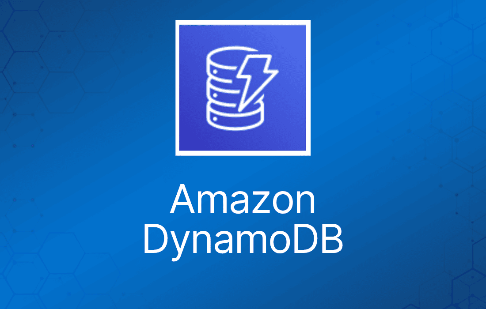

<p align="center">
  
  &nbsp;&nbsp;&nbsp;
  
  &nbsp;&nbsp;&nbsp;
</p>

# Agente de Notícias com IA

[](https://github.com/tvlemes/agente-ia-noticias/blob/main/LICENSE)


[]()

## 📁 Arquivos

* app/scraper/article_spider.py - Spider responsável por realizar a coleta de artigos na internet. **IMPORTANTE**:
Este spider é um exemplo genérico. Cada site possui uma estrutura HTML diferente, portanto os seletores CSS/XPath precisam ser adaptados ao site que será pesquisado;
* app/scraper/pipeline.py - Pipeline responsável por processar os artigos.
1. Recebe o artigo do Spider.
2. Cria um ID único.
3. Salva o artigo no DynamoDB.
4. Mantém o artigo na lista de resultados.
* app/scraper/runner.py - Runner responsável por executar o Scrapy;
* app/services/scraper_service.py - Serviço responsável por executar o Scrapy; 
* app/database/dynamodb.py - Módulo responsável pela comunicação com DynamoDB.
* app/streamlit_app.py - Interface gráfica do projeto.

## ⚙️ Criando o Ambiente Virtual Python

Para criar o Ambiente Virtual Python digite os comandos abaixo

```
# Cria o Ambiente Virtual
python -m venv .venv

# Ativa o Ambiente Virtual
.venv\Scripts\activate

# Instalando as dependências
pip install -r requirements.txt

# Desativandoo o Ambiente Virtual
deactivate
```


## ▶️ Executando o projeto
Primeiramente deve ser criado o banco de dados no Dynamodb:
```
cd scripts

python criar_tabela.py
```

Na raiz do projeto digite:
```
streamlit run app/streamlit_app.py
```

## 📘Comandos Boto3

Este é um breve tutorial do boto3.

1. Conectar ao DynamoDB:
```python
import boto3
dynamodb = boto3.resource(
    "dynamodb",
    endpoint_url="http://localhost:4566",
    region_name="us-east-1",
    aws_access_key_id="test",
    aws_secret_access_key="test"
)
```

2. Criar/acessar uma tabela:
```python
tabela = dynamodb.Table("artigos")
```

3. Listar tabelas:
```python
tabelas = dynamodb.tables.all()

for tabela in tabelas:
    print(tabela.name)
```

4. Criar tabela:
```python
tabela = dynamodb.create_table(
    TableName="artigos",

    KeySchema=[
        {
            "AttributeName": "id",
            "KeyType": "HASH"
        }
    ],

    AttributeDefinitions=[
        {
            "AttributeName": "id",
            "AttributeType": "S"
        }
    ],

    BillingMode="PAY_PER_REQUEST"
)
```

Tipos de dados do Dynamodb:
```
HASH = chave de partição
S    = String
N    = Number
B    = Binary
```

5. Inserir registro — put_item():
```python
tabela.put_item(
    Item={
        "id": "1",
        "titulo": "Inteligência Artificial",
        "autor": "Thiago",
        "ano": 2026
    }
)
```

6. Consultar um registro — get_item():
```python
response = tabela.get_item(
    Key={
        "id": "1"
    }
)

registro = response.get("Item")

print(registro)
```

7. Listar registros — scan():
```python
response = tabela.scan()

registros = response.get("Items", [])

for registro in registros:
    print(registro)
```

Para saber a quantidade:
```python
print(f"Total: {len(registros)}")
```

8. Consultar por chave — query():
```python
from boto3.dynamodb.conditions import Key

response = tabela.query(
    KeyConditionExpression=Key("id").eq("1")
)

registros = response["Items"]
```

9. Atualizar registro — update_item():
```python
response = tabela.update_item(
    Key={
        "id": "1"
    },

    UpdateExpression="SET titulo = :titulo",

    ExpressionAttributeValues={
        ":titulo": "Novo título"
    },

    ReturnValues="ALL_NEW"
)

print(response["Attributes"])
```

10. Atualizar vários campos:
```python
tabela.update_item(
    Key={
        "id": "1"
    },

    UpdateExpression="""
        SET titulo = :titulo,
            autor = :autor,
            ano = :ano
    """,

    ExpressionAttributeValues={
        ":titulo": "Machine Learning",
        ":autor": "Thiago",
        ":ano": 2026
    }
)
```

11. Excluir registro — delete_item():
```python
tabela.delete_item(
    Key={
        "id": "1"
    }
)
```

12. Excluir tabela:
```python
tabela.delete()
```

Também existe o client, que dá acesso às operações de baixo nível do DynamoDB.
```python
dynamodb_client = boto3.client(
    "dynamodb",
    endpoint_url="http://localhost:4566",
    region_name="us-east-1",
    aws_access_key_id="test",
    aws_secret_access_key="test"
)
```

Listar tabelas
```python
response = dynamodb_client.list_tables()

print(response["TableNames"])
```
Descrever tabela
```python
response = dynamodb_client.describe_table(
    TableName="artigos"
)

print(response["Table"])
```

Deletar tabela
```python
dynamodb_client.delete_table(
    TableName="artigos"
)
```

## 👨‍💻 Sobre

👤 Autor: Thiago Vilarinho Lemes <br>
🏠 Home: https://thiagolemes.netlify.app/ \
🔗 LinkedIn: <a href="https://www.linkedin.com/in/thiago-v-lemes-b1232727" target="_blank">Thiago Lemes</a><br>
✉️ e-mail:contatothiagolemes@gmail.com | lemes_vilarinho@yahoo.com.br